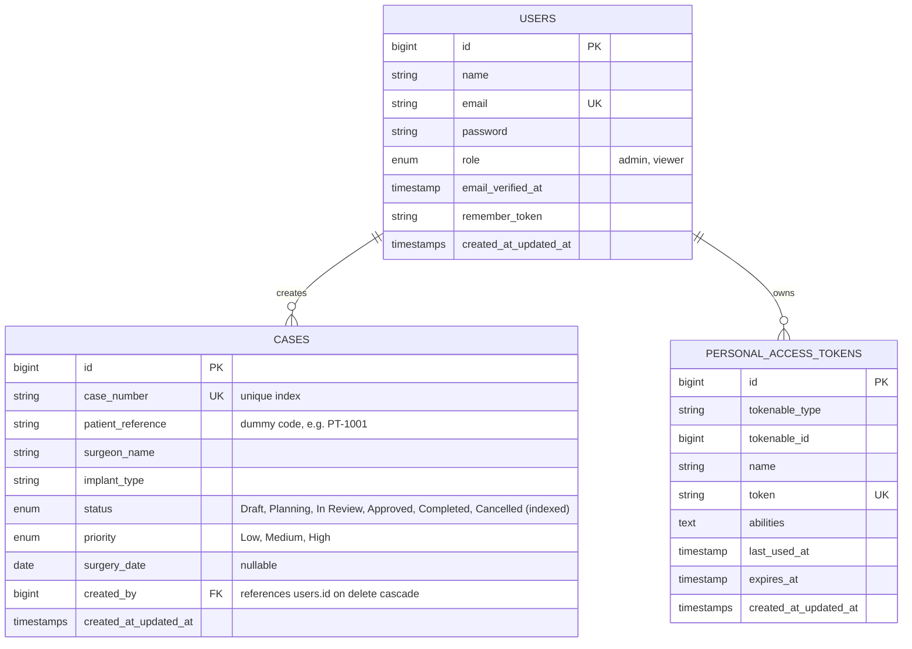

# Database Schema Documentation

**Project:** Medical Case Manager  
**Database:** MySQL (in-memory SQLite for automated tests)  
**Author:** Software Developer Intern Assignment (@Jajal Medical)

---

## 1. Entity Relationship Overview

---

## 2. Table Specifications

### `users`
Stores application user accounts for both Web and REST API authentication.

| Column | Type | Constraints / Modifiers | Description |
|---|---|---|---|
| `id` | BIGINT UNSIGNED | Primary Key, Auto-increment | Unique user identifier |
| `name` | VARCHAR(255) | Not Null | User full name |
| `email` | VARCHAR(255) | Unique Index, Not Null | Login email address |
| `email_verified_at`| TIMESTAMP | Nullable | Email verification timestamp |
| `password` | VARCHAR(255) | Not Null | Hashed password (bcrypt) |
| `role` | ENUM('admin', 'viewer') | Default: `'viewer'`, Not Null | User role controlling CRUD access |
| `remember_token` | VARCHAR(100) | Nullable | Remember-me authentication token |
| `created_at` | TIMESTAMP | Nullable | Record creation timestamp |
| `updated_at` | TIMESTAMP | Nullable | Record update timestamp |

### `cases`
Stores medical implant cases and lifecycle state from draft to completion.

| Column | Type | Constraints / Modifiers | Description |
|---|---|---|---|
| `id` | BIGINT UNSIGNED | Primary Key, Auto-increment | Unique internal ID |
| `case_number` | VARCHAR(255) | Unique Index, Not Null | Unique clinical identifier (e.g., `CASE-2026-0001`) |
| `patient_reference`| VARCHAR(255) | Not Null | Anonymized patient code (e.g., `PT-1001`) |
| `surgeon_name` | VARCHAR(255) | Not Null | Operating surgeon name |
| `implant_type` | VARCHAR(255) | Not Null | Medical device implant description |
| `status` | ENUM | Index, Default: `'Draft'`, Not Null | Allowed: `Draft`, `Planning`, `In Review`, `Approved`, `Completed`, `Cancelled` |
| `priority` | ENUM | Default: `'Medium'`, Not Null | Allowed: `Low`, `Medium`, `High` |
| `surgery_date` | DATE | Nullable | Scheduled or performed surgery date |
| `created_by` | BIGINT UNSIGNED | Foreign Key (`users.id`), On Delete Cascade | User who created the case record |
| `created_at` | TIMESTAMP | Nullable | Case registration timestamp |
| `updated_at` | TIMESTAMP | Nullable | Last modification timestamp |

### `personal_access_tokens` (Laravel Sanctum)
Stores API Bearer tokens used for authenticating REST API requests.

| Column | Type | Constraints / Modifiers | Description |
|---|---|---|---|
| `id` | BIGINT UNSIGNED | Primary Key, Auto-increment | Token identifier |
| `tokenable_type` | VARCHAR(255) | Index | Polymorphic model class (`App\Models\User`) |
| `tokenable_id` | BIGINT UNSIGNED | Index | Polymorphic user ID |
| `name` | VARCHAR(255) | Not Null | Token label (e.g., `'api-token'`) |
| `token` | VARCHAR(64) | Unique Index, Not Null | SHA-256 hashed token string |
| `abilities` | TEXT | Nullable | Token abilities / scopes |
| `last_used_at` | TIMESTAMP | Nullable | Timestamp of most recent request |
| `expires_at` | TIMESTAMP | Nullable | Token expiration timestamp |
| `created_at` | TIMESTAMP | Nullable | Token creation timestamp |
| `updated_at` | TIMESTAMP | Nullable | Token update timestamp |

---

## 3. Relationships & Data Integrity

1. **User to Cases (`1:N`)**: A user may create multiple medical cases (`cases.created_by` references `users.id`). Deleting a user cascades to their created cases.
2. **Case Number Uniqueness**: A database-level unique index on `cases.case_number` prevents duplicates, backed by Laravel Form Request validation (`StoreCaseRequest` and `UpdateCaseRequest`).
3. **Status Query Performance**: An index on `cases.status` optimizes dashboard count queries and status filtering on the cases list.
